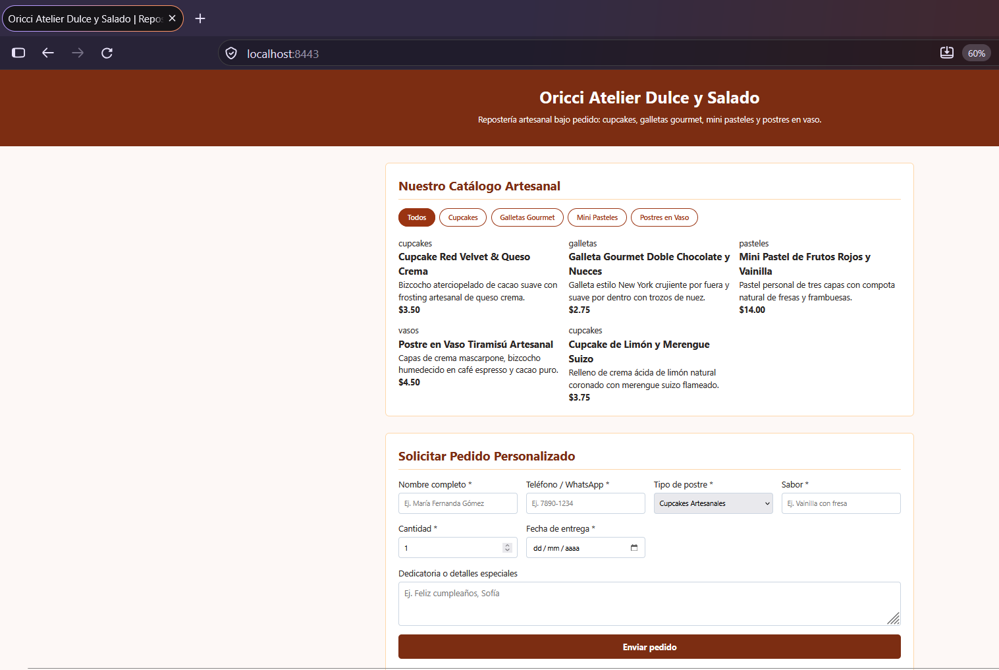
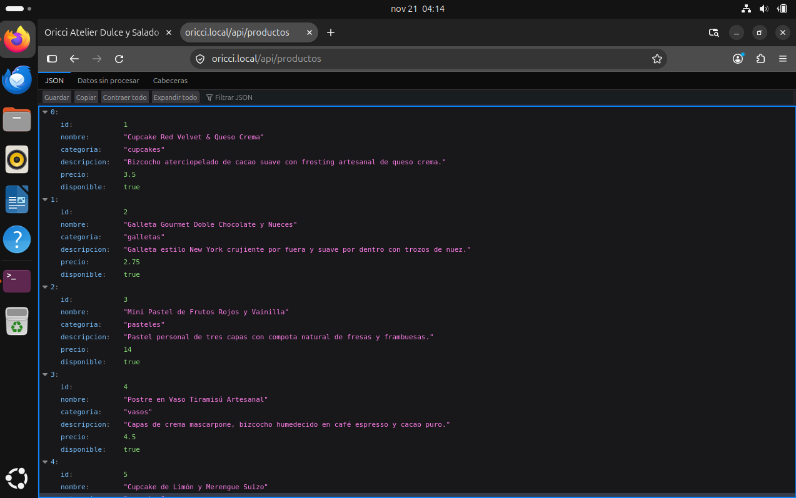

# 🧁 Oricci Atelier Dulce y Salado — Plataforma Web y API

Plataforma web de e-commerce y gestión de pedidos personalizados para repostería artesanal (cupcakes, galletas gourmet, mini pasteles y postres en vaso). Desarrollada con arquitectura cliente-servidor contenedorizada, proxy inverso y cifrado HTTPS.

---

## 👥 Integrantes del Equipo

| Nombre Completo | Carné | Rol en esta Fase |
| :--- | :--- | :--- |
| **Jekssy Odeli Bernal Montesinos** (Líder) | U20250299 | Arquitectura, Repositorio GitHub & Documentación |
| **Edgar Rigofredo Bermudez Magaña** | U20251147 | Backend Core (Express + TS), Docker & `/health` |
| **Leonardo Israel Quintanilla Vasquez** | U20241478 | API de Catálogo (`/api/productos`) |
| **Ricardo Abraham Pereyra Zelayandia** | U20230750 | API de Pedidos Personalizados (`/api/pedidos`) |
| **Meybeline Abigail Corvera Cruz** | U20261631 | Frontend Estático (HTML5 / CSS / Tailwind) |
| **Gustavo Nahum Marquez Cruz** | U20261632 | Integración Frontend-API (`fetch`) |
| **Edwin Moises Cruz Perla** | U20240211 | Servidor Web (Apache/IIS), ProxyPass & SSL/HTTPS |

---

## 🏗️ Arquitectura del Sistema

El sistema separa el contenido estático del procesamiento dinámico mediante un **Reverse Proxy** protegido por TLS/SSL:

```text
[ Navegador Cliente ]
         │
         ▼  (HTTPS - Puerto 443 | Certificado SSL Local)
[ Servidor Web: Apache / IIS ]
    ├── /          ──► Sirve archivos estáticos (HTML5 / CSS / JS)
    └── /api/*     ──► Reverse Proxy (ProxyPass)
                             │
                             ▼  (HTTP Interno - Puerto 3000)
                 [ Contenedor Docker: Node.js + Express + TS ]
                             │
                             ▼
                 [ Respuestas JSON: /api/productos, /api/pedidos, /health ]
```

---

## 📁 Estructura del Repositorio

```text
oricci-atelier-web/
├── backend/    # API Express + TypeScript + Dockerfile
├── frontend/   # index.html, styles.css, app.js (sitio estático)
├── config/     # oricci-ssl.conf (VirtualHost de Apache con HTTPS y ProxyPass)
└── docs/       # Capturas de evidencia (HTTPS y API)
```

## 🔌 Endpoints de la API

| Método | Ruta | Descripción |
| :--- | :--- | :--- |
| GET | `/health` | Estado del contenedor |
| GET | `/api/productos` | Catálogo completo de postres |
| GET | `/api/productos/:categoria` | Filtra por `cupcakes`, `galletas`, `pasteles` o `vasos` (404 si no hay registros) |
| GET | `/api/pedidos` | Lista los pedidos registrados |
| POST | `/api/pedidos` | Registra un pedido personalizado (400 si faltan campos obligatorios) |

## 🚀 Cómo levantar el proyecto (Ubuntu Server + Apache)

**1. Clonar el repositorio**

```bash
git clone https://github.com/odelibernal503-png/oricci-atelier-web.git
cd oricci-atelier-web
```

**2. Levantar el contenedor del backend (puerto 3000)**

```bash
cd backend
docker build -t oricci-backend .
docker run -d -p 3000:3000 --name oricci-api oricci-backend
curl http://localhost:3000/health
cd ..
```

**3. Copiar el frontend a Apache**

```bash
sudo mkdir -p /var/www/oricci
sudo cp -r frontend/* /var/www/oricci/
```

**4. Generar el certificado SSL local con mkcert**

```bash
mkcert -install
sudo mkdir -p /etc/apache2/ssl
sudo mkcert -cert-file /etc/apache2/ssl/oricci.local.pem \
            -key-file  /etc/apache2/ssl/oricci.local-key.pem \
            oricci.local localhost 127.0.0.1
echo "127.0.0.1 oricci.local" | sudo tee -a /etc/hosts
```

> La llave privada (`oricci.local-key.pem`) **no** se sube al repositorio; está bloqueada en `.gitignore`.

**5. Activar Apache con HTTPS y Reverse Proxy**

```bash
sudo a2enmod ssl proxy proxy_http rewrite headers
sudo cp config/oricci-ssl.conf /etc/apache2/sites-available/
sudo a2ensite oricci-ssl.conf
sudo systemctl restart apache2
```

**6. Probar**

- Sitio: https://oricci.local
- API a través del proxy: https://oricci.local/api/productos
- Salud: https://oricci.local/health

## 🖼️ Evidencias

| Sitio con candado HTTPS | API vía Reverse Proxy |
| :---: | :---: |
|  |  |

## 🔒 Seguridad

El Reverse Proxy (`ProxyPass /api/`) permite que el navegador consuma la API con rutas relativas bajo HTTPS, evitando contenido mixto. Ninguna llave privada (`*.key`, `*-key.pem`, `*.pfx`) forma parte del repositorio.

## ⏭️ Fuera de alcance en esta fase

Clúster de 3 nodos con Docker Compose y balanceador Nginx (Fases 3 y 4).